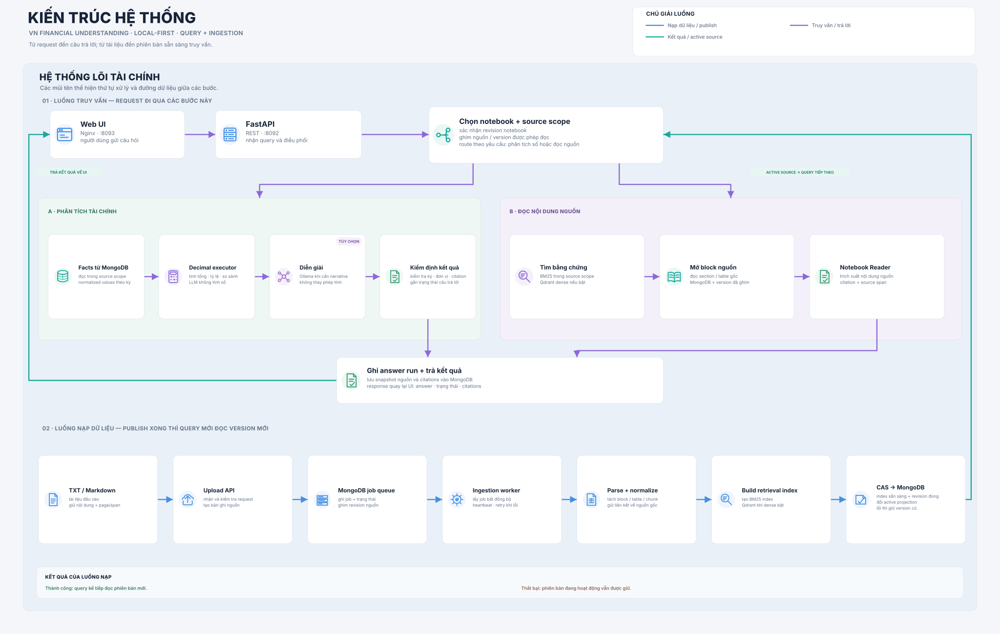
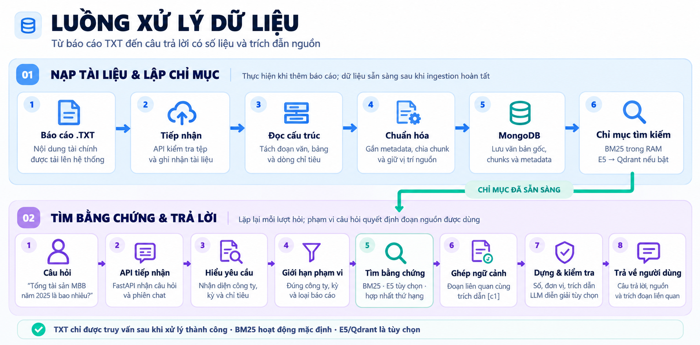

# VN Financial RAG

> A Vietnamese financial-report Q&A and analysis assistant that answers from ingested documents and cites its sources.

[English](README.en.md) · [Tiếng Việt](README.md)

[Getting started](#getting-started) · [Architecture](#architecture) · [Security policy (Vietnamese)](SECURITY.md)

## Overview

VN Financial RAG helps users look up and summarize figures from TXT/Markdown financial reports using Vietnamese questions. It identifies the company, reporting period, and report type, then links numeric results back to their sources so users can see the file name, page, and relevant excerpt.

The project is intended for analysts, investors, financial-data practitioners, and developers experimenting with a RAG workflow for Vietnamese corporate reports. Ingestion and query processing run as separate services. MongoDB stores documents and chunks, while Qdrant stores E5 embeddings in persistent Docker volumes.

## Motivation

Financial reports use different names for the same metrics and often contain multi-level tables and columns comparing reporting periods. Plain text search can return the wrong company, year, or table row. This project combines keyword and vector search, preserves row and table structure with provenance, and validates figures and citations before returning an answer.

## Key Features

- Ingest TXT/Markdown documents through the UI or API; successfully ingested documents become available to queries immediately.
- Detect company tickers, names, years, reporting periods, and report types to scope retrieval.
- Combine BM25 and E5 dense retrieval; schemas support table groups and parent/child row relationships.
- Look up financial metrics, compare years or companies, list breakdowns, and answer selected multi-metric analysis questions.
- Organize sources into notebooks to scope Q&A, save conversations, and create notes linked to evidence.
- Run durable ingestion jobs with status tracking and retries when MongoDB is enabled.
- Return figures with units and citations; calculations can show formulas and their source inputs.
- Store source text and chunks in MongoDB, and embeddings in Qdrant keyed by passage hash and model revision. Both run in Docker with persistent volumes.
- Build BM25 and dense indexes in memory from MongoDB/Qdrant at startup. BM25 remains available while the E5 index is rebuilt in the background.

## Architecture



Nginx serves the web UI on port `8093` and forwards requests to FastAPI on port `8092`. MongoDB stores source text, chunks, notebooks, and conversations; Qdrant stores vectors. The API and ingestion worker read jobs from MongoDB. At startup, the API loads the BM25 and dense indexes into memory. Query Understanding identifies the company and reporting period before retrieval; numeric answers are derived from source data and validated. Ollama is optional and can provide narrative explanations.

### TXT ingestion and answering flow



When a TXT file is ingested, the system validates its content, splits paragraphs and tables into chunks, and attaches metadata and source links. MongoDB stores the text and chunks. BM25 is indexed by default; E5 vectors are stored in Qdrant when dense retrieval is enabled. After ingestion, a question is analyzed by company, period, and metric. The system retrieves supporting evidence, validates the answer, and returns it to the UI with citations and source excerpts.

After starting the system and ingesting a document, try questions such as:

- `Tổng tài sản của DEMO cuối năm 2025 là bao nhiêu?`
- `Tổng nợ phải trả của DEMO đầu năm 2025 là bao nhiêu?`
- `So sánh doanh thu thuần của DEMO năm 2025 với năm 2024.`

These example questions are in Vietnamese because the assistant is designed for Vietnamese financial reports.

## Tech Stack

| Layer | Technology |
|---|---|
| Language | Python 3.11+ |
| API | FastAPI, Pydantic, Uvicorn |
| Documents and chunks | MongoDB |
| Conversations and turns | MongoDB |
| Vectors | Qdrant |
| Retrieval | BM25, E5 dense retrieval, Reciprocal Rank Fusion |
| UI / reverse proxy | HTML, CSS, JavaScript, Nginx |
| Deployment | Docker Compose |
| Optional embeddings / explanations | Ollama-compatible endpoint |

## Getting Started

### Prerequisites

- Docker Desktop or Docker Engine with Docker Compose v2.
- Ollama or a compatible endpoint if you want to enable E5 embeddings and model-generated explanations. Ollama is not required for deterministic numeric answers.

### Installation and configuration

Clone the repository, then create the configuration file:

```powershell
git clone https://github.com/mduy2k5/VN-Financial-RAG-ChatBot.git
Set-Location VN-Financial-RAG-ChatBot
Copy-Item .env.example .env
```

By default, the system runs BM25 only to keep memory use low. To enable E5, configure `FINANCIAL_EMBEDDING_URL` and `FINANCIAL_EMBEDDING_MODEL` for an available endpoint/model, then set `FINANCIAL_ENABLE_DENSE=true`.

### Run

```powershell
docker compose -f docker-compose.financial-standalone.yml up -d --build
```

Open the UI at [http://127.0.0.1:8093](http://127.0.0.1:8093). The API is available at [http://127.0.0.1:8092](http://127.0.0.1:8092), with readiness at [http://127.0.0.1:8092/health/ready](http://127.0.0.1:8092/health/ready).

By default, Compose binds the API/UI and MongoDB administration port to loopback (`127.0.0.1`): API `8092`, UI `8093`, and MongoDB `27019`. Qdrant does not publish a host port. MongoDB and Qdrant data are stored in `vn-financial-understanding_financial-mongo-data` and `vn-financial-understanding_financial-qdrant-data`, respectively. Named volumes survive `docker compose down`; remove them only when you intend to delete the data.

When upgrading from the older SQLite version, run the migrator once before starting the new API:

```powershell
docker compose -f docker-compose.financial-standalone.yml --profile migration run --rm financial-rag-migrate
docker compose -f docker-compose.financial-standalone.yml up -d --build
```

The migrator reads the old `vn-financial-understanding_financial-rag-data` volume without deleting it. It copies documents/chunks to MongoDB and vectors to Qdrant. Re-running it updates or upserts records by the same keys instead of creating duplicates.

### Local models in Docker

If your machine has an NVIDIA GPU and the `ollama_ollama_data` volume already contains the E5/Qwen models, you can run the model runtime with the API/UI:

```powershell
docker compose -f docker-compose.financial-standalone.yml -f docker-compose.financial-models.yml up -d --build
```

This override uses the existing Ollama image and models, sets the embedding/chat endpoints on the internal `financial-models:11434` network, and publishes the model port on loopback. The default embedding model is `qllama/multilingual-e5-large:q4_k_m`; set `FINANCIAL_MODELS_VOLUME` to use a different model volume. Wait until `dense_retrieval=ready` appears in the health status before measuring E5/hybrid retrieval. While indexing is in progress, the API continues serving requests with BM25.

### Docker resource limits

The Compose files set a maximum configured budget of about **10 CPUs and 4032 MiB of RAM** when all services are enabled, including Ollama, initialization, and migration. This is a limit in the sample Compose configuration, not a minimum host requirement. Actual needs depend on document size, concurrent requests, and whether dense retrieval/Ollama is enabled.

| Service | CPU limit | RAM limit |
| --- | ---: | ---: |
| MongoDB | 1 | 512 MiB |
| MongoDB init | 0.25 | 256 MiB |
| Qdrant | 1 | 256 MiB |
| API | 2 | 512 MiB |
| Ingest worker | 1 | 256 MiB |
| Migration | 0.5 | 128 MiB |
| UI | 0.25 | 64 MiB |
| Ollama | 4 | 2048 MiB |

`memswap_limit` equals `mem_limit`, so containers do not use additional swap. The values in the table are reference ceilings for the local configuration; adjust `cpus`, `mem_limit`, and `memswap_limit` for each service in the Compose files as needed. Ollama handles one request at a time and keeps one model in memory; switching between embedding and chat models may require loading a different model. The override points both the API and ingestion worker to this Ollama instance. Ollama's limits apply only when running the `financial-models` service with the combined Compose command above; an Ollama instance running separately at `host.docker.internal` is not subject to these limits. Compose does not limit GPU VRAM. Increase the RAM limits for larger workloads or if a container runs out of memory; on lower-memory machines, disable dense retrieval or skip the Ollama override.

After changing the configuration, rerun `up -d` with both Compose files to recreate the containers and apply the limits.

## Usage

1. Open the UI and upload a `.txt`, `.md`, or `.markdown` file.
2. Wait for ingestion to complete.
3. Ask a question in Vietnamese and open a citation to view the document, page, and source excerpt.

You can call the answer endpoint directly after ingesting a report:

```powershell
$body = @{ query = "Tổng tài sản hợp nhất của ABB năm 2024 là bao nhiêu?" } | ConvertTo-Json
Invoke-RestMethod -Method Post `
  -Uri "http://127.0.0.1:8092/api/v1/financial/answer" `
  -ContentType "application/json" `
  -Body $body
```

The system can answer a question only when the corresponding report has been ingested.

## API

| Method | Endpoint | Purpose |
|---|---|---|
| `GET` | `/health/ready` | Check readiness |
| `POST` | `/api/v1/financial/ingest` | Ingest one TXT/Markdown document |
| `POST` | `/api/v1/financial/ingest/batch` | Synchronously ingest a batch of documents |
| `POST` | `/api/v1/financial/ingest/jobs` | Create a durable ingestion job |
| `GET` | `/api/v1/financial/ingest/jobs/{job_id}` | Check job status |
| `POST` | `/api/v1/financial/ingest/jobs/{job_id}/retry` | Retry a failed job |
| `GET` | `/api/v1/financial/documents` | List documents in the store |
| `DELETE` | `/api/v1/financial/documents/{logical_key}` | Delete a document |
| `POST` | `/api/v1/financial/query/understand` | Inspect question understanding |
| `POST` | `/api/v1/financial/retrieve` | Inspect retrieved evidence |
| `POST` | `/api/v1/financial/answer` | Return an answer with citations and validation |
| `GET`, `POST` | `/api/v1/notebooks` | List or create a notebook |
| `POST` | `/api/v1/notebooks/{id}/sources` | Attach a report to a notebook |
| `POST` | `/api/v1/notebooks/{id}/answer` | Ask a question within a notebook's scope |
| `POST` | `/api/v1/notebooks/{id}/notes` | Save a note |

OpenAPI/Swagger UI: [http://127.0.0.1:8092/docs](http://127.0.0.1:8092/docs).

## Project Structure

```text
.
├── benchmarks/cross_project_rag/  # Benchmark tools; corpus inputs are kept separate
├── docs/
│   ├── assets/architecture/        # SVG/PNG architecture diagrams
│   ├── design/
│   └── repository/                # Data policy and release guidance
├── financial_python/
│   ├── evaluation/                 # Benchmarks and evaluation tools
│   ├── sample_data/                # Fictional report for examples
│   ├── src/financial_rag/          # API, parsing, retrieval, and validation
│   ├── tests/                      # Self-contained tests
│   └── pyproject.toml
├── financial_ui/                   # Web UI and Nginx reverse proxy
├── schemas/                        # Financial-report schemas and aliases
├── .env.example
├── docker-compose.financial-models.yml
├── docker-compose.financial-standalone.yml
├── LICENSE
└── README.md
```

## Example and Testing

The repository includes a short Markdown report and a small benchmark fixture containing entirely fictional data. The `DEMO` company code, company names, figures, and citations in the [sample report](financial_python/sample_data/DEMO_SYNTHETIC_2025.md) are fabricated and exist only to test parsing, retrieval, and source-grounded answers.

After ingesting the sample file, try questions such as:

- `Tổng tài sản của DEMO cuối năm 2025 là bao nhiêu?`
- `So sánh doanh thu thuần của DEMO năm 2025 với năm 2024.`

Python 3.11 or later is required. From the `financial_python` directory, run:

```powershell
python -m pip install -e ".[dev]"
python -m pytest
python -m ruff check .
python -m mypy src
python -m financial_rag.evaluation.benchmark
```

The checks above are run manually; the repository does not configure GitHub Actions. Real datasets, corpus-dependent benchmarks, detailed results, and QA screenshots are kept outside the Git snapshot. See the [repository data policy](docs/repository/REPOSITORY_READINESS.md) for guidance. The included sample is for functional testing and is not an accuracy measurement on real reports.

## Known Limitations

- Only TXT and Markdown are supported; PDF is out of scope.
- Answers are based only on ingested reports; input OCR/extraction quality affects results.
- MongoDB stores raw text and chunks. Qdrant stores unique vectors keyed by passage hash in a separate collection for each model revision. Ollama provides a digest; other endpoints need `FINANCIAL_EMBEDDING_REVISION` if they do not return a revision. Persistent vector caching is disabled when a revision cannot be determined. BM25 remains available while the dense index loads or updates.
- E5 requires a compatible embedding endpoint and sufficient resources. Dense retrieval can be disabled to use BM25 only.
- In-depth financial analysis has not been validated on a sufficiently large independent holdout set.
- The MVP UI has no accounts; conversations are shared within a local MongoDB instance, with a limit of 24 conversations and 40 turns per conversation.

## License

This repository is released under the Apache License 2.0. See [LICENSE](LICENSE) for the full text.
