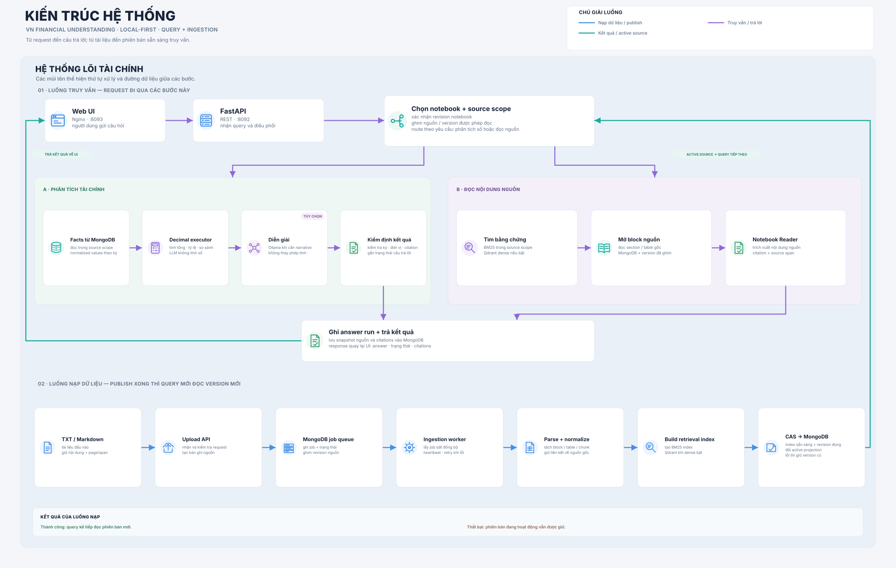
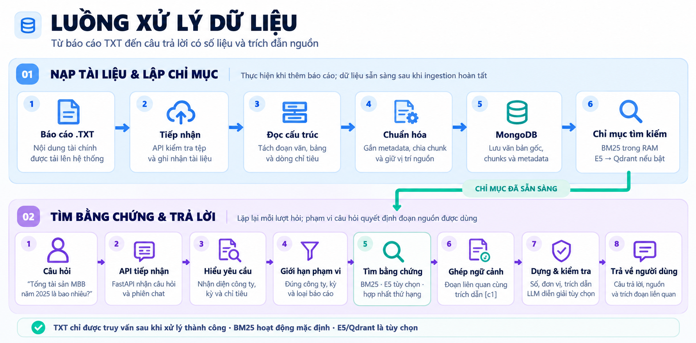

# VN Financial RAG

> Trợ lý hỏi đáp và phân tích báo cáo tài chính Việt Nam, trả lời dựa trên tài liệu đã nạp và kèm trích dẫn nguồn.

[English](README.en.md) · [Tiếng Việt](README.md)

[Hướng dẫn nhanh](#getting-started) · [Kiến trúc](#architecture) · [Bảo mật](SECURITY.md)

## Overview

VN Financial RAG giúp người dùng tra cứu và tổng hợp số liệu từ báo cáo tài chính TXT/Markdown bằng câu hỏi tiếng Việt. Hệ thống nhận diện doanh nghiệp, kỳ báo cáo và loại báo cáo; kết quả số được đối chiếu với nguồn để hiển thị tên tệp, trang và trích đoạn liên quan.

Dự án hướng tới nhà phân tích, nhà đầu tư, người làm dữ liệu tài chính và developer cần thử nghiệm một quy trình RAG chuyên biệt cho báo cáo doanh nghiệp Việt Nam. Ingestion và truy vấn chạy trên dịch vụ riêng; MongoDB lưu tài liệu/chunks còn Qdrant lưu các embedding E5 trong các Docker volume riêng.

> **Trạng thái: experimental / nghiên cứu.** Đây là MVP để thử nghiệm hỏi đáp báo cáo tài chính tiếng Việt, chưa được nghiệm thu bằng holdout độc lập trên báo cáo thực. Kết quả có thể chọn nhầm dòng hoặc chỉ tiêu; hãy mở citation và đối chiếu tài liệu trước khi sử dụng. Chưa nên dùng làm nguồn quyết định tài chính trong production.

## Motivation

Báo cáo tài chính có nhiều cách đặt tên chỉ tiêu, bảng nhiều tầng và cột so sánh giữa các kỳ. Tìm kiếm văn bản đơn thuần có thể trả nhầm doanh nghiệp, năm hoặc dòng bảng. Dự án kết hợp tìm kiếm từ khóa và vector, giữ cấu trúc dòng/bảng cùng provenance, rồi kiểm tra số liệu và citation trước khi trả lời.

## Key Features

- Nạp tài liệu TXT/Markdown qua giao diện hoặc API; tài liệu mới được đưa vào truy vấn ngay sau khi ingestion thành công.
- Nhận diện mã doanh nghiệp, tên gọi, năm, kỳ và loại báo cáo để giới hạn phạm vi tìm kiếm.
- Kết hợp BM25 và E5 dense retrieval; schema hỗ trợ chia nhóm bảng và quan hệ dòng cha/con.
- Hỗ trợ tra cứu chỉ tiêu, so sánh năm/doanh nghiệp, liệt kê cơ cấu và một số câu hỏi phân tích nhiều chỉ tiêu.
- Tổ chức nguồn theo notebook để giới hạn phạm vi hỏi đáp, lưu hội thoại và ghi chú có liên kết về bằng chứng.
- Hỗ trợ ingestion theo job bền vững, theo dõi trạng thái và retry khi chạy với MongoDB.
- Trả lời số liệu với đơn vị và citation; phép tính có thể hiển thị công thức cùng các đầu vào nguồn.
- Dùng MongoDB để lưu văn bản nguồn và chunks, Qdrant để lưu embedding theo hash passage và phiên bản model; cả hai chạy trong Docker với volume bền vững.
- Dựng BM25 và dense index trong RAM từ MongoDB/Qdrant khi khởi động; BM25 vẫn phục vụ trong lúc E5 dựng lại index nền.

## Architecture



Web UI được Nginx phục vụ tại cổng `8093` và chuyển tiếp yêu cầu tới FastAPI ở cổng `8092`. MongoDB lưu văn bản nguồn, chunks, notebook và hội thoại; Qdrant lưu các vector embedding. API cùng ingest worker đọc job từ MongoDB. Khi API khởi động, BM25 và dense index được nạp vào RAM. Query Understanding xác định công ty và kỳ trước khi truy xuất; câu trả lời số lấy từ dữ liệu nguồn rồi được kiểm định. Ollama là tùy chọn cho phần diễn giải.

### Luồng xử lý TXT và trả lời



Khi nạp tệp TXT, ingestion kiểm tra nội dung, tách đoạn văn và bảng thành chunks, rồi gắn metadata cùng liên kết về nguồn. MongoDB lưu văn bản và chunks; BM25 được lập chỉ mục mặc định, còn E5 tạo vector trong Qdrant khi dense retrieval được bật. Sau khi nạp xong, câu hỏi được phân tích theo công ty, kỳ và chỉ tiêu; hệ thống tìm bằng chứng phù hợp, kiểm tra câu trả lời rồi trả kết quả về UI kèm trích dẫn và đoạn nguồn.

Sau khi khởi chạy và nạp tài liệu, có thể thử các câu hỏi như:

- `Tổng tài sản của DEMO cuối năm 2025 là bao nhiêu?`
- `Tổng nợ phải trả của DEMO đầu năm 2025 là bao nhiêu?`
- `So sánh doanh thu thuần của DEMO năm 2025 với năm 2024.`

## Tech Stack

| Layer | Công nghệ |
|---|---|
| Ngôn ngữ | Python 3.11+ |
| API | FastAPI, Pydantic, Uvicorn |
| Lưu tài liệu / chunks | MongoDB |
| Lưu hội thoại / lượt hỏi đáp | MongoDB |
| Lưu vectors | Qdrant |
| Retrieval | BM25, E5 dense retrieval, Reciprocal Rank Fusion |
| UI / reverse proxy | HTML, CSS, JavaScript, Nginx |
| Triển khai | Docker Compose |
| Embedding / diễn giải tùy chọn | Ollama-compatible endpoint |

## Getting Started

### Prerequisites

- Docker Desktop hoặc Docker Engine với Docker Compose v2.
- Ollama hoặc endpoint tương thích nếu muốn bật E5 embedding và diễn giải bằng mô hình. Ollama không bắt buộc cho câu trả lời số xác định.

### Installation and configuration

Clone repository, sau đó tạo volume lưu dữ liệu và file cấu hình:

```powershell
git clone https://github.com/mduy2k5/VN-Financial-RAG-ChatBot.git
Set-Location VN-Financial-RAG-ChatBot
Copy-Item .env.example .env
```

Mặc định hệ thống chỉ chạy BM25 để giữ mức dùng RAM thấp. Để bật E5, cấu hình `FINANCIAL_EMBEDDING_URL` và `FINANCIAL_EMBEDDING_MODEL` theo endpoint/model sẵn có rồi đặt `FINANCIAL_ENABLE_DENSE=true`.

### Run

```powershell
docker compose -f docker-compose.financial-standalone.yml up -d --build
```

Mở giao diện tại [http://127.0.0.1:8093](http://127.0.0.1:8093). API mặc định ở [http://127.0.0.1:8092](http://127.0.0.1:8092); readiness tại [http://127.0.0.1:8092/health/ready](http://127.0.0.1:8092/health/ready).

Compose chỉ bind API/UI và cổng quản trị MongoDB vào loopback (`127.0.0.1`) theo mặc định: API `8092`, UI `8093` và MongoDB `27019`. Qdrant không publish cổng ra host. MongoDB và Qdrant lưu lần lượt vào `vn-financial-understanding_financial-mongo-data` và `vn-financial-understanding_financial-qdrant-data`. Các named volume còn nguyên sau `docker compose down`; chỉ xóa chúng khi chủ ý xóa dữ liệu.

Khi nâng cấp từ bản SQLite cũ, trước khi khởi động API mới hãy chạy migrator một lần:

```powershell
docker compose -f docker-compose.financial-standalone.yml --profile migration run --rm financial-rag-migrate
docker compose -f docker-compose.financial-standalone.yml up -d --build
```

Migrator đọc volume cũ `vn-financial-understanding_financial-rag-data` mà không xóa nó. Nó chép tài liệu/chunks sang MongoDB và vectors sang Qdrant; chạy lại sẽ cập nhật/upsert cùng khóa thay vì tạo bản sao.

### Model local trong Docker

Máy có NVIDIA GPU và volume `ollama_ollama_data` chứa model E5/Qwen có thể chạy runtime model cùng API/UI:

```powershell
docker compose -f docker-compose.financial-standalone.yml -f docker-compose.financial-models.yml up -d --build
```

Override này dùng image Ollama và model đã có, đặt endpoint embedding/chat trên mạng nội bộ `financial-models:11434`, và mở cổng model ở loopback. Model embedding mặc định là `qllama/multilingual-e5-large:q4_k_m`; `FINANCIAL_MODELS_VOLUME` cho phép đổi volume model. Chờ `dense_retrieval=ready` trong health trước khi đo E5/hybrid; lúc indexing, API tiếp tục phục vụ bằng BM25.

### Giới hạn tài nguyên Docker

Các file Compose đặt giới hạn tổng cấu hình tối đa khoảng **10 CPU và 4032 MiB RAM** khi bật toàn bộ dịch vụ, tính cả Ollama, init và migration. Đây là giới hạn của cấu hình Compose mẫu, không phải yêu cầu tối thiểu của máy. Nhu cầu thực tế phụ thuộc kích thước tài liệu, số yêu cầu đồng thời và việc bật dense retrieval/Ollama.

| Service | CPU tối đa | RAM tối đa |
| --- | ---: | ---: |
| MongoDB | 1 | 512 MiB |
| Mongo init | 0,25 | 256 MiB |
| Qdrant | 1 | 256 MiB |
| API | 2 | 512 MiB |
| Ingest worker | 1 | 256 MiB |
| Migration | 0,5 | 128 MiB |
| UI | 0,25 | 64 MiB |
| Ollama | 4 | 2048 MiB |

`memswap_limit` bằng `mem_limit` để container không dùng thêm swap. Các giá trị trong bảng là mức trần tham khảo cho cấu hình local; có thể điều chỉnh `cpus`, `mem_limit` và `memswap_limit` theo từng service trong các file Compose. Ollama xử lý một yêu cầu đồng thời và chỉ giữ một model trong bộ nhớ; chuyển giữa embedding và chat có thể phải nạp lại model. Override trỏ cả API và ingest worker tới Ollama này. Giới hạn Ollama chỉ áp dụng khi chạy service `financial-models` bằng lệnh Compose kết hợp ở trên; Ollama chạy riêng tại `host.docker.internal` không chịu giới hạn này. Compose không giới hạn VRAM GPU. Tăng giới hạn RAM khi workload lớn hoặc container bị OOM; trên máy ít RAM có thể tắt dense retrieval hoặc không chạy override Ollama.

Sau khi sửa cấu hình, chạy lại lệnh `up -d` với cả hai file Compose để tạo lại container và áp dụng giới hạn.

## Usage

1. Mở UI, tải lên tệp `.txt`, `.md` hoặc `.markdown`.
2. Đợi ingestion báo thành công.
3. Hỏi bằng tiếng Việt; mở citation để xem tài liệu, trang và đoạn nguồn.

Có thể gọi endpoint trả lời trực tiếp sau khi đã nạp báo cáo:

```powershell
$body = @{ query = "Tổng tài sản hợp nhất của ABB năm 2024 là bao nhiêu?" } | ConvertTo-Json
Invoke-RestMethod -Method Post `
  -Uri "http://127.0.0.1:8092/api/v1/financial/answer" `
  -ContentType "application/json" `
  -Body $body
```

Câu hỏi chỉ có thể trả lời khi báo cáo tương ứng đã được nạp vào kho.

## API

| Phương thức | Endpoint | Mục đích |
|---|---|---|
| `GET` | `/health/ready` | Kiểm tra trạng thái sẵn sàng |
| `POST` | `/api/v1/financial/ingest` | Nạp một tài liệu TXT/Markdown |
| `POST` | `/api/v1/financial/ingest/batch` | Nạp đồng bộ một lô tài liệu |
| `POST` | `/api/v1/financial/ingest/jobs` | Tạo job ingestion bền vững |
| `GET` | `/api/v1/financial/ingest/jobs/{job_id}` | Xem trạng thái job |
| `POST` | `/api/v1/financial/ingest/jobs/{job_id}/retry` | Thử lại job lỗi |
| `GET` | `/api/v1/financial/documents` | Liệt kê tài liệu trong kho |
| `DELETE` | `/api/v1/financial/documents/{logical_key}` | Xóa tài liệu |
| `POST` | `/api/v1/financial/query/understand` | Xem phân tích câu hỏi |
| `POST` | `/api/v1/financial/retrieve` | Xem bằng chứng được truy xuất |
| `POST` | `/api/v1/financial/answer` | Trả lời kèm citation và kiểm định |
| `GET`, `POST` | `/api/v1/notebooks` | Liệt kê hoặc tạo notebook |
| `POST` | `/api/v1/notebooks/{id}/sources` | Gắn báo cáo vào notebook |
| `POST` | `/api/v1/notebooks/{id}/answer` | Hỏi trong phạm vi notebook |
| `POST` | `/api/v1/notebooks/{id}/notes` | Lưu ghi chú |

OpenAPI/Swagger: [http://127.0.0.1:8092/docs](http://127.0.0.1:8092/docs).

## Project Structure

```text
.
├── benchmarks/cross_project_rag/  # Công cụ benchmark; corpus đầu vào để riêng
├── docs/
│   ├── assets/architecture/        # Sơ đồ kiến trúc dạng SVG/PNG
│   ├── design/
│   └── repository/                # Chính sách dữ liệu và hướng dẫn phát hành
├── financial_python/
│   ├── evaluation/                 # Benchmark và công cụ đánh giá
│   ├── sample_data/                # Báo cáo hư cấu dùng làm ví dụ
│   ├── src/financial_rag/          # API, parsing, retrieval và validation
│   ├── tests/                      # Kiểm thử tự đủ dữ liệu
│   └── pyproject.toml
├── financial_ui/                   # Giao diện web và Nginx proxy
├── schemas/                        # Schema báo cáo và alias tài chính
├── .env.example
├── docker-compose.financial-models.yml
├── docker-compose.financial-standalone.yml
├── LICENSE
└── README.md
```

## Example and Testing

Repository có một báo cáo Markdown ngắn và bộ nhãn benchmark nhỏ dùng dữ liệu hoàn toàn hư cấu. Mã `DEMO`, tên công ty, giá trị và citation trong [báo cáo minh họa](financial_python/sample_data/DEMO_SYNTHETIC_2025.md) chỉ để thử parser, retrieval và câu trả lời có nguồn.

Ví dụ sau khi nạp file minh họa vào hệ thống:

- `Tổng tài sản của DEMO cuối năm 2025 là bao nhiêu?`
- `So sánh doanh thu thuần của DEMO năm 2025 với năm 2024.`

Cần Python 3.11 trở lên. Từ thư mục `financial_python`:

```powershell
python -m pip install -e ".[dev]"
python -m pytest
python -m ruff check .
python -m mypy src
python -m financial_rag.evaluation.benchmark
```

Các lệnh kiểm tra ở trên có thể chạy cục bộ. GitHub Actions chạy pytest, Ruff và mypy; benchmark dữ liệu tổng hợp dưới đây chạy riêng. Dữ liệu thật, nhãn/kết quả benchmark phụ thuộc corpus và ảnh QA được giữ ngoài snapshot Git; xem [chính sách dữ liệu repository](docs/repository/REPOSITORY_READINESS.md).

### Benchmark công khai

Benchmark mặc định có thể chạy lại trên một báo cáo hoàn toàn hư cấu và hai câu hỏi tra cứu. Kết quả gần nhất dùng BM25, tắt dense retrieval, `top_k=5`:

| Phép đo | Kết quả | Cách đọc |
|---|---:|---|
| Số ca / nguồn | 2 / 1 báo cáo DEMO | Hai câu tra cứu tài sản và doanh thu năm 2025; dữ liệu tổng hợp |
| Recall@5 | 1.00 | Cả hai ca đều tìm thấy trang đã gán nhãn |
| MRR | 1.00 | Trang đúng đứng đầu trong cả hai ca |
| Precision@5 | 0.80 | Tính trên 5 kết quả truy xuất cho mỗi ca |
| Citation-page recall | 1.00 | Các trang được gán nhãn đều có trong tập trang được dẫn từ kết quả truy xuất |
| Citation-page precision | 0.50 | Một nửa số trang khác nhau trong tập dẫn từ kết quả truy xuất khớp nhãn |
| Giá trị và đơn vị trong bằng chứng | 1.00 / 1.00 | Cả hai giá trị mong đợi và đơn vị đều xuất hiện trong bằng chứng đã truy xuất |

Đây là **smoke test chức năng gồm hai ca**, không phải ước lượng độ chính xác trên báo cáo thật. Benchmark đo retrieval và việc đưa giá trị/đơn vị vào bằng chứng; không chấm chất lượng câu trả lời cuối của LLM, khả năng đọc PDF/OCR, thuyết minh đa dạng hay khả năng tổng quát hóa. `Citation-page precision` được tính trên các trang khác nhau trong citation của tập kết quả truy xuất, không phải điểm chấm citation cho câu trả lời cuối. Các số này giúp kiểm tra demo và tái hiện quy trình; chúng chưa đủ để kết luận phù hợp cho nghiệp vụ cụ thể. Xem [hướng dẫn benchmark](financial_python/evaluation/README.md), [bộ câu hỏi](financial_python/evaluation/demo_cases.jsonl) và [báo cáo tổng hợp](financial_python/sample_data/DEMO_SYNTHETIC_2025.md).

## Known Limitations

- Chỉ hỗ trợ TXT và Markdown; PDF nằm ngoài phạm vi.
- Câu trả lời chỉ dựa trên các báo cáo đã nạp; chất lượng OCR/extraction đầu vào ảnh hưởng kết quả.
- Chưa có holdout độc lập được rà soát để xác nhận chất lượng trên báo cáo tài chính thực; sai kỳ, đơn vị hoặc dòng chỉ tiêu vẫn có thể xảy ra.
- MongoDB lưu raw text và chunks; Qdrant lưu các vectors duy nhất theo hash passage trong collection riêng cho mỗi revision model. Ollama cung cấp digest; endpoint khác cần `FINANCIAL_EMBEDDING_REVISION` nếu không trả revision. Không xác định được revision thì cache vector bền bị tắt. BM25 phục vụ trong lúc dense index được nạp hoặc cập nhật.
- E5 cần endpoint embedding tương thích và tài nguyên phù hợp. Có thể tắt dense retrieval để chạy BM25.
- Phân tích tài chính chuyên sâu chưa được xác nhận bằng bộ holdout độc lập đủ rộng.
- UI MVP chưa có tài khoản; các cuộc trò chuyện được lưu chung cho instance local trong MongoDB, tối đa 24 cuộc trò chuyện và 40 lượt hỏi đáp mỗi cuộc trò chuyện.

## License

Repository được phát hành theo Apache License 2.0. Xem toàn văn tại [LICENSE](LICENSE).
